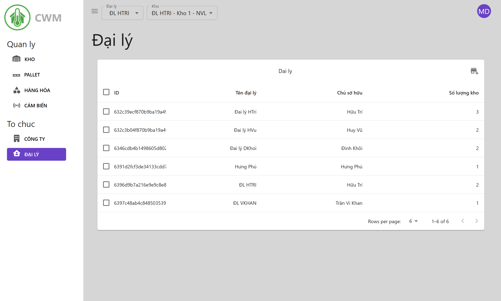
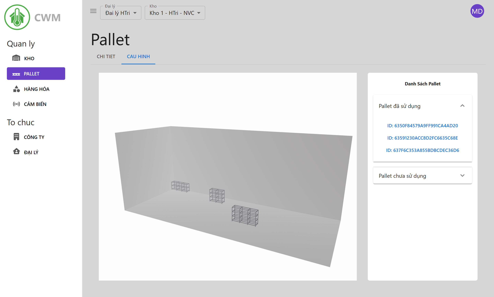
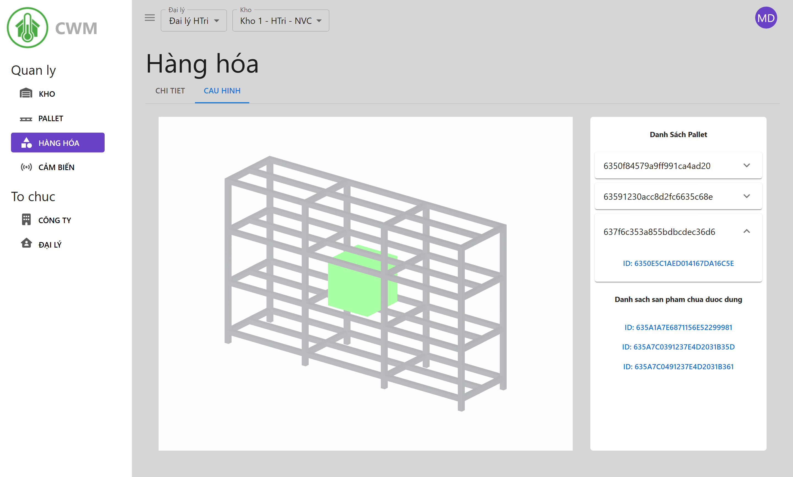
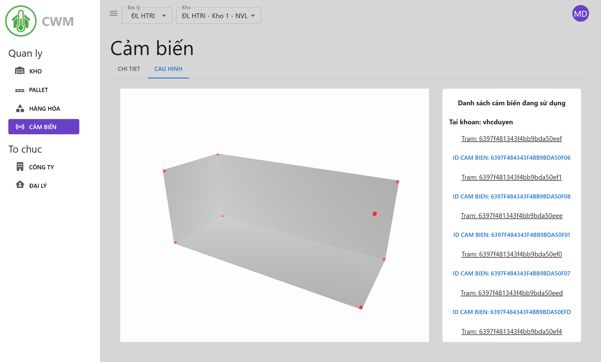

# CSM · Cold Storage Management ❄️

> **Hệ thống quản lý và trực quan hóa không gian kho lạnh công nghiệp ứng dụng mô hình 3D tương tác. Số hóa cấu trúc kho thực tế, giúp người vận hành định vị chính xác vị trí pallet, luồng luân chuyển hàng hóa và mạng lưới cảm biến nhiệt độ – độ ẩm theo thời gian thực.**

**Dự án của Toàn Nguyễn** · Trực quan hóa không gian 3D & Quản lý vận hành kho

[Xem tính năng](#features) · [Tài liệu kỹ thuật & cài đặt](TECHNICAL.md)

---

## 📌 Executive Summary (Tổng quan dự án)

| Thông số               | Chi tiết                                                                       |
| :--------------------- | :----------------------------------------------------------------------------- |
| **Project Name**       | **Cold Storage Management System (CSM)**                                       |
| **Project Type**       | Hệ thống quản lý và trực quan hóa kho lạnh công nghiệp 3D                      |
| **Đối tượng sử dụng**  | Nhà quản lý chuỗi cung ứng, chuyên viên điều phối kho và kỹ thuật viên giám sát |
| **Phạm vi phát triển** | Thiết kế giao diện quản trị, tương tác mô hình không gian 3D và dữ liệu cảm biến |
| **Trạng thái**         | Bản mẫu giao diện 3D tương tác; module giám sát thời gian thực đang hoàn thiện |

---

## 🎯 Problem & Solution (Bài toán & Giải pháp)

- **Problem:** Quản lý kho lạnh truyền thống phụ thuộc vào bảng tính và danh sách 2D phẳng, gây khó khăn lớn trong việc hình dung vị trí thực tế của từng pallet, cấu trúc xếp chồng nhiều tầng và tình trạng phân bố nhiệt độ tại các góc chết trong kho.
- **Solution:** Kết hợp hệ thống quản trị dữ liệu với mô hình không gian 3D tương tác thời gian thực (React Three Fiber & Spline). Người vận hành có thể xoay, phóng to, kiểm tra vị trí từng pallet, tra cứu hàng hóa và đối chiếu tọa độ cảm biến IoT trực tiếp trong không gian ba chiều.

---

## ✨ Key Features (Tính năng nổi bật)

| Tính năng                         | Giá trị mang lại                                                                                             |
| :-------------------------------- | :----------------------------------------------------------------------------------------------------------- |
| **Khám phá kho bằng mô hình 3D**  | Quan sát toàn cảnh cấu trúc kho, xoay chuyển góc nhìn tự do, nhận diện nhanh khoảng trống và mật độ lưu trữ |
| **Bố trí pallet và hàng hóa**     | Định vị chính xác tọa độ pallet trong kho, tra cứu chi tiết sản phẩm và theo dõi liên kết hàng hóa đa tầng   |
| **Hiển thị vị trí cảm biến IoT**  | Đặt các điểm đo nhiệt độ/độ ẩm vào đúng tọa độ không gian thực, hỗ trợ phát hiện sớm điểm rủi ro nhiệt độ    |
| **Quản lý đa đại lý & kho hàng**  | Chuyển đổi linh hoạt giữa các chi nhánh, tổ chức dữ liệu phân tầng theo ngữ cảnh đại lý - kho hàng rõ ràng   |

<strong>Xem thêm: pallet, sản phẩm và cảm biến</strong>

---

## 👨‍💻 Competencies & Contributions (Năng lực & Đóng góp)

- **Phân tích nghiệp vụ:** Thể hiện quan hệ giữa đại lý, kho, pallet, hàng hóa và cảm biến trong cùng trải nghiệm quản lý.
- **Trực quan hóa thông tin:** Biến dữ liệu vị trí thành mô hình mà người vận hành dễ quan sát.
- **Tổ chức trải nghiệm phức tạp:** Giữ lựa chọn kho, danh sách và màn hình bố trí theo cùng một ngữ cảnh.

---

## 📈 Future Roadmap (Hướng phát triển)

- [ ] Hoàn thiện màn hình giám sát và lịch sử dữ liệu cảm biến.
- [ ] Bổ sung báo cáo phục vụ theo dõi và vận hành kho.

---

## 👤 Author & Contact

- **Tác giả:** Toàn Nguyễn
- **GitHub:** [@nhttoan0809](https://github.com/nhttoan0809)
- **Tài khoản sinh viên (cùng tác giả):** [@toanb1805926](https://github.com/toanb1805926)

---

## 📄 License

Xem [thông tin giấy phép và tài nguyên bên thứ ba](TECHNICAL.md#license).
