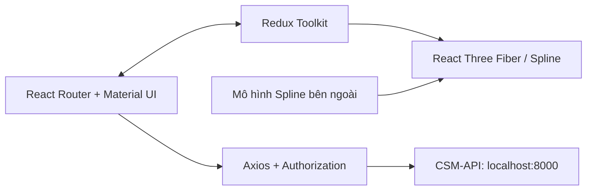

# Technical Guide · Cold Storage Management System

[Tổng quan dự án và năng lực thể hiện](README.md)

Tài liệu dành cho lập trình viên và agents: phạm vi triển khai, công nghệ, kiến trúc, cấu hình và cách kiểm tra. Các đường dẫn tương đối bắt đầu từ thư mục gốc repository.

[Phạm vi](#scope) · [Skills & Tech Stack](#stack) · [Kiến trúc & API](#architecture) · [Cài đặt](#setup) · [Điểm kỹ thuật](#highlights) · [Hướng cải thiện](#roadmap) · [Tham khảo](#references) · [Giấy phép](#license)

<a id="scope"></a>

## 📍 Implementation Scope (Phạm vi triển khai)

Repo chứa frontend quản lý đại lý, kho, pallet, sản phẩm và cảm biến; backend được dẫn chiếu tại [CSM-API](https://github.com/nhttoan0809/CSM-API). Không suy ra database hoặc chính sách phân quyền server từ frontend này.

Scene 3D kết hợp dữ liệu vị trí/kích thước với mô hình Spline. API client hỗ trợ tài khoản IoT, trạm, dữ liệu và vị trí cảm biến. Token được lưu ở `localStorage` dưới khóa `accessToken-CSM` và gắn vào header `Authorization`; route chính gọi `auth/reLogin` để khôi phục phiên.

Chưa thấy RBAC theo vai trò hoặc kênh WebSocket. [Trang giám sát kho](src/pages/warehouse/MonitorPage.js) mới có tiêu đề; dashboard giám sát và báo cáo chưa hoàn thiện. Repo chưa ghi nhận URL production cố định.

---

<a id="stack"></a>

## 🛠 Skills & Tech Stack (Kỹ năng & Công nghệ)

| Tầng kiến trúc        | Công nghệ chính                                           | Lý do phù hợp với triển khai hiện tại                             |
| :-------------------- | :-------------------------------------------------------- | :---------------------------------------------------------------- |
| **Frontend**          | React 18, JavaScript, React Router 6                      | Route lồng nhau cho chi tiết/cấu hình từng nhóm nghiệp vụ         |
| **UI & Forms**        | Material UI 5, Emotion, Formik, Yup                       | Component giao diện, biểu mẫu và validation                       |
| **3D Visualization**  | React Three Fiber 8, Drei, `@splinetool/r3f-spline`       | Kết hợp mô hình kho/pallet với state React                        |
| **State Management**  | Redux Toolkit, React Redux                                | Chia state theo user, agent, warehouse, pallet, product và sensor |
| **API Communication** | Axios, `qs` được import trong mã                          | Interceptor token và body dạng URL-encoded                        |
| **Build & Tools**     | Create React App, `react-scripts` 5, npm, Testing Library | Có script chạy/build/test; chưa thấy bộ test nghiệp vụ            |

Scene Spline được tải từ URL ngoài trong `src/constant`; hiển thị 3D cần mạng và tài nguyên đó còn truy cập được. Công nghệ backend/database cần đối chiếu riêng trong CSM-API.

---

<a id="architecture"></a>

## 🏗 System Architecture & API Design (Kiến trúc & Thiết kế API)



Các endpoint dưới đây được đối chiếu từ **API client**, chưa xác minh hoạt động của backend:

| Method | Endpoint                                                                                                          | Mục đích                                          |
| :----- | :---------------------------------------------------------------------------------------------------------------- | :------------------------------------------------ |
| `POST` | `/auth/login`                                                                                                     | Đăng nhập bằng username/password dạng URL-encoded |
| `GET`  | `/auth/reLogin`                                                                                                   | Khôi phục thông tin phiên                         |
| `GET`  | `/agent/{agentId}/warehouse/get_all`                                                                              | Danh sách kho của đại lý                          |
| `POST` | `/agent/{agentId}/warehouse/{warehouseId}/pallet/{palletId}/add_to_warehouse`                                     | Đặt pallet vào kho với tham số `position`         |
| `POST` | `/agent/{agentId}/warehouse/{warehouseId}/product/{productId}/add_to_pallet`                                      | Gán sản phẩm và vị trí vào pallet                 |
| `GET`  | `/agent/{agentId}/warehouse/{warehouseId}/iot_account/{accountId}/station/{stationId}/sensor/{sensorId}/get_data` | Dữ liệu cảm biến                                  |

Route giao diện chính: `/login`, `/register`, `/warehouse`, `/pallet`, `/goods`, `/sensor`, `/company`, `/agent`. Xem đầy đủ tại [src/App.js](src/App.js).

---

<a id="setup"></a>

## 🚀 Getting Started (Cài đặt & Chạy thử)

### Điều kiện tiên quyết (Prerequisites)

- Node.js và npm; repo chưa khóa phiên bản Node.
- Backend CSM-API cùng dữ liệu/tài khoản tương ứng. Xem hướng dẫn trong repo backend.
- Trình duyệt hỗ trợ WebGL và Internet để tải scene Spline.

### Các bước cài đặt (Quick Steps)

1. **Clone repository và cài dependencies:**

   ```bash
   git clone https://github.com/nhttoan0809/CSM.git
   cd CSM
   npm ci
   ```

2. **Cấu hình backend:** `baseURL` được viết trực tiếp trong [src/api/axiosClient.js](src/api/axiosClient.js) là `http://localhost:8000`. Sửa nếu backend ở địa chỉ khác và cấu hình backend cho phép origin frontend. Repo chưa có `.env.example` hoặc logic đọc base URL từ `.env`.

3. **Chạy frontend:**

   ```bash
   npm start
   ```

   Truy cập `http://localhost:3000/login`. Backend chạy riêng; lệnh trên không khởi động API/database.

4. **Build và kiểm tra:**

   ```bash
   npm run build
   npm test -- --watchAll=false --passWithNoTests
   ```

   Bản build nằm trong `build/`; host cần trả `index.html` cho route SPA. Repo chưa có test nghiệp vụ; lệnh test có thể kết thúc mà không chạy test nào.

**Lưu ý khi cài mới:** `qs` được import trong API client nhưng chưa khai báo trực tiếp trong `package.json`. Nếu gặp lỗi resolve module, cần bổ sung dependency trực tiếp. [src/pages/Authentication.js](src/pages/Authentication.js) tham chiếu hook không có trong repo và không được route hiện tại sử dụng.

---

<a id="highlights"></a>

## 🔍 Implementation Highlights (Điểm kỹ thuật & Module)

- **Các module triển khai:**
  - [src/components/3D](src/components/3D): scene kho, pallet, sản phẩm và cảm biến.
  - [src/utilityFunc](src/utilityFunc): ánh xạ vị trí, vị trí mặc định và chuyển đổi kích thước kho.
  - [src/redux](src/redux): state nghiệp vụ và ngữ cảnh lựa chọn.
  - [src/api](src/api): hợp đồng gọi backend theo cấp đại lý/kho và interceptor token.
- **Thử thách kỹ thuật (Key Technical Challenge):** Giữ cấu hình vị trí nhất quán với scene 3D. Mã tách phép chuyển đổi tọa độ khỏi component và chia scene theo đối tượng. Repo chưa có benchmark xác nhận mức cải thiện hiệu năng.

---

<a id="roadmap"></a>

## 📈 Learnings & Technical Roadmap (Bài học & Hướng cải thiện)

### Bài học rút ra (Key Learnings)

- Ánh xạ tọa độ nghiệp vụ sang mô hình 3D và chia scene thành các thành phần độc lập.
- Quản lý state nhiều cấp đại lý/kho bằng Redux và route lồng nhau.
- Phân biệt điều hướng khi thiếu token với xác thực/phân quyền thực sự trên server.

### Kế hoạch nâng cấp (Roadmap)

Các mục sau là hướng cải thiện đề xuất, chưa phải tính năng đã hoàn thành.

- [ ] Hoàn thiện giám sát kho, lịch sử dữ liệu cảm biến và báo cáo.
- [ ] Bổ sung RBAC phối hợp với backend và xử lý token hết hạn.
- [ ] Đưa base URL vào biến môi trường, khai báo `qs` trực tiếp và chuẩn hóa cấu hình Axios.
- [ ] Kiểm thử chuyển đổi tọa độ, lựa chọn kho và bố trí hàng.
- [ ] Kiểm soát vòng đời request, lỗi API và trạng thái tải tài nguyên 3D.

---

<a id="references"></a>

## 📚 References (Tài liệu liên quan)

- [CSM-API](https://github.com/nhttoan0809/CSM-API): backend được README gốc dẫn chiếu.
- [Ảnh quản lý cảm biến](docs/screenshots/sensor.png), [danh sách pallet](docs/screenshots/list-of-pallet.png), [danh sách sản phẩm](docs/screenshots/list-of-product.png).

---

<a id="license"></a>

## 📄 License

Repo chưa có file `LICENSE` hoặc khai báo giấy phép trong `package.json`. Chưa xác định giấy phép phân phối; không mặc định áp dụng MIT.
